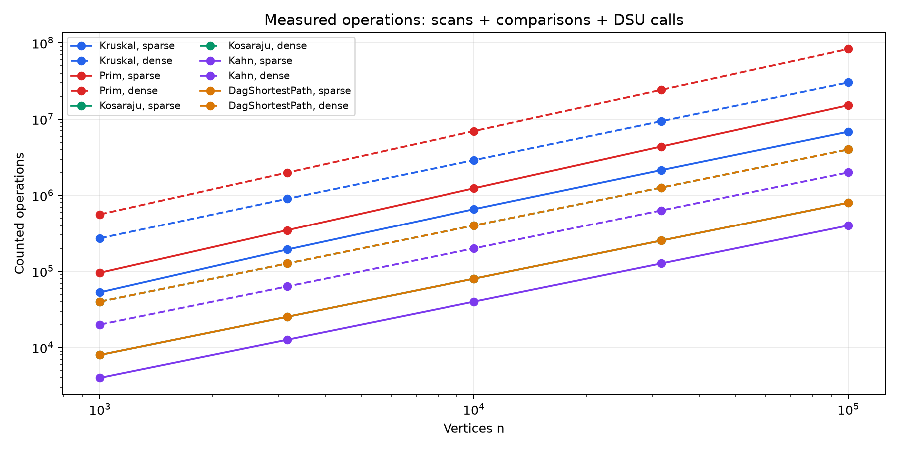
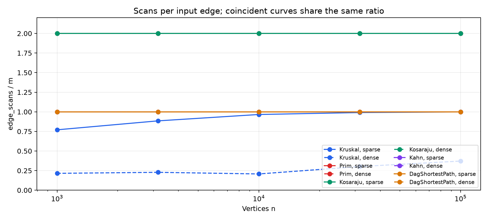
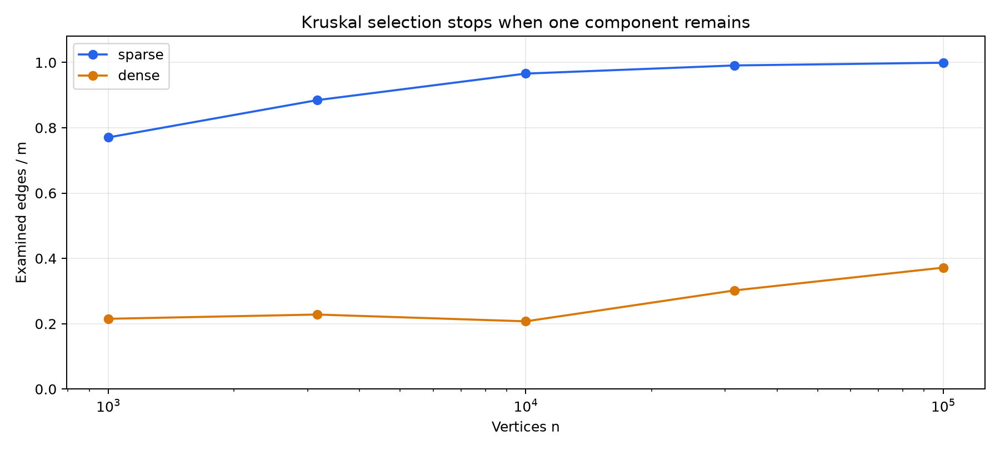

# DAA Assignment 3 Graphs
Yerzhan Moldir | SE-2509 | 23 October 2026

## Graph algorithms and complexity

Yerzhan Moldir | SE-2509 | 23 October 2026. The project connects city districts with minimum road cost and analyzes dependent jobs using directed graphs. All required algorithms use one adjacency-list Graph class. The benchmark reproduces every reference result.

| Algorithm | Time | Extra space | Reason |
| --- | --- | --- | --- |
| DSU find / union | O(alpha(V)) amortized | O(V) total; O(1) per call | Union by size limits height; compression flattens paths. |
| Kruskal | O(V + E log E) | O(V + E) | Sort edges, then near-constant amortized DSU operations. |
| Prim (lazy heap) | O(V + E log(E+1)) | O(V + E) | Up to E queued edges; each heap operation is logarithmic. |
| Kosaraju | O(V + E) | O(V + E) | Two iterative DFS passes and one transpose graph. |
| Kahn | O(V + E) | O(V) | Each vertex leaves the queue once; each edge updates a degree. |
| DAG paths | O(V + E) | O(V) | Topological order, validation, degrees and one relaxation pass. |

V is the number of vertices and E the number of input edges. Graph storage itself is O(V+E) and is excluded from the extra-space column. Kruskal includes its sorted copy and output; lazy Prim can hold O(E) queued edges, including parallel edges. On simple connected graphs log E = O(log V), giving the familiar O(E log V) Prim bound. DSU initialization costs O(V). Empty and disconnected inputs still require vertex bookkeeping.

The generator resets Random(42) separately for each graph kind and each size/density case. When a=b, only b is sampled again; this detail is necessary to reproduce the reference values. Undirected generation shuffles vertices, creates a random spanning tree, then adds edges; DAG generation orients edges by shuffled rank. All generated weights are 1..1000. Ten cases produce 30 graph instances and 50 algorithm rows. Every row passes the assignment reference values, Kruskal/Prim agreement and scan checks.

Validation uses JUnit 5: randomized DSU labels, 100 connected MST cross-checks, exhaustive tiny MST subsets, all-pairs BFS SCC checks up to 200 vertices, cycle/order checks, Bellman-Ford on 100 DAGs with negative weights, path restoration and long distances. The 100000-vertex chain completes iterative SCC with measured stack depth 100000. All three data files are used in tests.

## Correctness and algorithm selection

<b>Cut property.</b> Consider a cut that respects the edges already chosen. Let e be a minimum-weight edge crossing it. Take an MST that does not contain e and add e, creating a cycle. This cycle contains another crossing edge f, whose weight is at least the weight of e. Replacing f with e preserves a spanning tree and cannot increase its weight. Thus there is an MST containing the chosen edges together with e. Kruskal uses cuts between DSU components, while Prim uses the cut between visited and unvisited vertices. Applying the same argument separately inside each connected component proves correctness of the returned forest.

<b>Induction on topological order.</b> Every predecessor of a vertex occurs earlier in a topological order. Each indegree-zero vertex starts at zero, which is equivalent to a zero-weight edge from a virtual super-source. Assume that distances of all earlier vertices are already optimal. Every path to the current vertex ends with an incoming edge from one of those earlier vertices. Relaxing every such edge therefore considers the best possible last step. The current distance is consequently optimal before its outgoing edges are processed, completing the induction. Negative weights do not invalidate this argument because a DAG has no cycles; in a general graph negative cycles can make a finite shortest distance impossible, and the DAG ordering argument is unavailable.

| Situation | Choice | Reason |
| --- | --- | --- |
| Sparse, undirected; edge list | Kruskal | Sorting and DSU are simple; no adjacency heap is needed. |
| Undirected; adjacency lists available | Prim | Grow through local edges with a priority queue. |
| Truly dense undirected graph | Array Prim alternative | An O(V^2) implementation can beat heap or sorting bounds; not implemented here. |
| Directed; cycles possible | Kosaraju | Identify mutually reachable groups before scheduling. |
| Need scheduling order or cycle detection | Kahn | Indegrees expose ready jobs and detect remaining cyclic jobs. |
| Weighted DAG; negative edges allowed | DAG paths | One topological pass; no priority queue or repeated passes. |
| General graph with negative edges | Bellman-Ford | Checks negative cycles; used as a small-test oracle here. |

Kruskal and Prim restart or retain separate components to return a minimum spanning forest. Self-loops cannot join DSU components and are never selected by Prim. Kahn reports a cycle if fewer than V vertices leave the queue. DAG parents identify the predecessor producing each improvement; following parents reaches a source because topological positions strictly decrease.

## Counters versus formulas

Scans count main processing loops: Kosaraju DFS passes scan 2E; Kahn queue processing and DAG relaxation scan E each; Prim scans 2E adjacency entries. Transpose construction, indegree setup and validators are excluded from scans, although they remain linear work. Comparisons count sorting/heap weight comparisons and relaxation distance comparisons. DSU operations count find calls plus successful unions, including find calls made inside union. Stack depth is maximum explicit stack occupancy. The DAG benchmark reuses a precomputed order; run(g, metrics) also computes it when needed. Both public variants are O(V+E).

| Algorithm | Density | Normalization | Min - max |
| --- | --- | --- | --- |
| Kruskal | sparse | comparisons / (E log2 E) | 0.745 - 0.907 |
| Prim | sparse | comparisons / (E log2 E) | 1.829 - 1.934 |
| Kosaraju | sparse | scans / (V + E) | 1.600 - 1.600 |
| Kahn | sparse | scans / (V + E) | 0.800 - 0.800 |
| DagShortestPath | sparse | scans / (V + E) | 0.800 - 0.800 |
| Kruskal | dense | comparisons / (E log2 E) | 0.666 - 0.903 |
| Prim | dense | comparisons / (E log2 E) | 1.825 - 1.890 |
| Kosaraju | dense | scans / (V + E) | 1.905 - 1.905 |
| Kahn | dense | scans / (V + E) | 0.952 - 0.952 |
| DagShortestPath | dense | scans / (V + E) | 0.952 - 0.952 |

With E=4V or E=20V, the traversal ratios are exactly constant. Sorting and heap ratios remain in a bounded range over the measured sizes; finite measurements support the bounds but are not mathematical proofs. The denser family is still O(V) edges as V grows, rather than a truly quadratic dense graph.

Kruskal dsuOps/E ranges from 1.791 to 2.248 in sparse graphs and 0.465 to 0.794 in denser graphs. The ratio is bounded because each examined edge causes two find calls and each accepted edge one successful union. Early stopping changes the ratio. These call counters do not count parent-pointer steps, so they confirm the number of calls rather than independently prove inverse-Ackermann amortized time. Constant-size initialized arrays add O(V) work.

## Slope checks and scans per edge

A log-log slope is fitted by least squares to log(n), log(counter). Traversal scans have slope exactly 1.0000 because E is a fixed multiple of n. Kruskal sorts every edge but may stop selection early: edge scans are at most E, so those scans cannot establish its E log E sorting cost. The table reports both scan slopes and weight-comparison slopes. For this bounded 1..1000 weight distribution, adaptive sorting and ties can also flatten comparison growth; the theoretical worst-case sorting bound remains O(E log E). A slightly steeper scan curve can reflect connectivity and early stopping over this finite range, rather than prove a sorting logarithm.

| Algorithm | Density | Scan slope | Comparison slope |
| --- | --- | --- | --- |
| Kruskal | sparse | 1.0550 | 1.0545 |
| Kruskal | dense | 1.1194 | 1.0159 |
| Prim | sparse | 1.0000 | 1.1079 |
| Prim | dense | 1.0000 | 1.0903 |
| Kosaraju | sparse | 1.0000 | - |
| Kosaraju | dense | 1.0000 | - |
| Kahn | sparse | 1.0000 | - |
| Kahn | dense | 1.0000 | - |
| DagShortestPath | sparse | 1.0000 | 1.0000 |
| DagShortestPath | dense | 1.0000 | 1.0000 |

Kosaraju and Prim overlap at 2; Kahn and DAG relaxation overlap at 1. The two densities overlap for these algorithms. Kruskal is below or at 1 because it can stop after V-1 accepted edges. A flat scans-per-edge line confirms linear scan work for the traversal phase; preprocessing is also linear but is tracked separately by the counter convention.

## Kruskal stopping and measured time

Kruskal examines only a fraction of the denser edge list before all vertices connect; the sparse list often needs nearly every edge. Sorting still processes all E edges in both families. Prim scans all adjacency entries and performs many heap comparisons, so its heap work must also be considered when choosing between the algorithms. The input representation, available memory and actual counter values matter more than a blanket statement that one method is always faster.

On this run, medians at n=100000 ranged from 200.82 to 27382.95 ms across algorithms and densities. Small cases are affected strongly by JIT compilation, timer noise, allocation and garbage collection. Larger graphs increase allocation pressure, particularly for transpose graphs and lazy heap entries. Five-run medians reduce isolated disturbances but do not remove JVM and hardware effects. The counters and exact reference checks are the main reproducible evidence; the times describe this run only.

| Algorithm | Density | Median ms at n=100000 |
| --- | --- | --- |
| Kruskal | sparse | 315.189 |
| Prim | sparse | 1190.477 |
| Kosaraju | sparse | 2516.157 |
| Kahn | sparse | 528.572 |
| DagShortestPath | sparse | 200.822 |
| Kruskal | dense | 15157.173 |
| Prim | dense | 27382.953 |
| Kosaraju | dense | 2983.588 |
| Kahn | dense | 510.932 |
| DagShortestPath | dense | 397.108 |

Reproduction: mvn clean verify; mvn -q compile exec:java; python scripts/analyze.py. The CSV has 50 rows and raw_runs.csv contains 250 measured trials. One warm-up per algorithm/case is excluded. The benchmark fails on a reference mismatch, MST disagreement, invalid order or incorrect required scan count. Java and OS details are saved in results/environment.txt. Optional Tarjan and condensation bonuses are not included.

Sources: DAA Assignment 3 Graphs, sections 1-10 and reference table, supplied course PDF. Measurements: results/results.csv and results/raw_runs.csv produced by this project. AI assistance is acknowledged in README.md.
